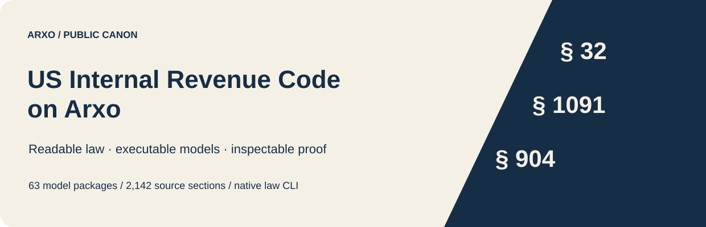
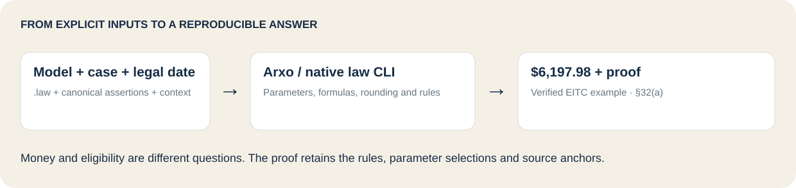
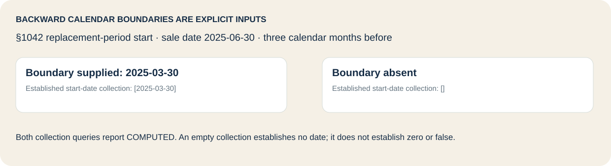
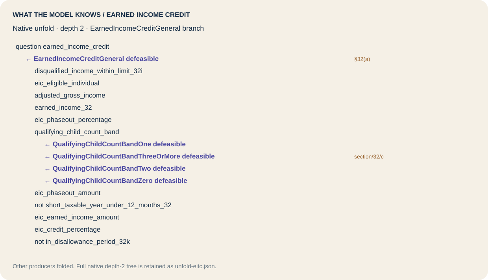

# US Internal Revenue Code on Arxo

Explore a pinned US federal tax model: read the `.law` sources, run explicit fictional cases, and inspect the rules and source anchors behind each answer.

**63 model packages · 2,142 source sections · npm-installed `law` CLI.** This repository distributes models on GitHub; it has no model npm package.

[Run an example](#run-an-example) · [Choose a model](docs/MODELS.md) · [Inspect a proof](#inspect-the-answer) · [Formalization depth](docs/DEPTH.md) · [Reproduce the release](docs/REPRODUCE.md)

## Run an example

Use Node.js 20+ on macOS ARM64 or Linux x64. `@arxo/cli@0.2.4` is the current published CLI verified for this release; the exact pin makes the example reproducible.

```sh
npm install -g @arxo/cli@0.2.4
git clone https://github.com/arxohq/arxo-irc.git
cd arxo-irc
node tools/prepare.mjs
law eval examples/eitc
```

`prepare.mjs` verifies and decompresses the three pinned reader worlds. Calculation is performed by Arxo. The EITC collection contains:

```json
{"currency":"USD","type":{"name":"urn:law:std#Money"},"value":"6197.98"}
```

The native result is `COMPUTED`, with a canonical result hash and a `proofGraph`. The amount is a decimal Money value; this is the model's earned income credit, not total tax due or a filed tax return.



## See the complete input

The fictional joint-filing example supplies earned income **$32,000**, AGI **$35,000**, a complete two-child roster, and investment-income facts. Eligibility is explicitly supplied; this calculation does not adjudicate it.

Read [every statement in input.lawcase](examples/eitc/input.lawcase), its [compiled canonical case](examples/eitc/case.json) and the [question](examples/eitc/question.lawql). Statements have origin `case_input`. The legal date is **2025-06-30**; the tax-year entity and the source edition are distinct from this date.

The two-child 2025 parameter rows retain the $17,880 earned-income amount and $30,470 joint-return phaseout threshold from [IRS Rev. Proc. 2024-40 §2.06](https://www.irs.gov/pub/irs-drop/rp-24-40.pdf).

The underlying statute snapshot is **USCODE-2024-title26**, with the pinned amendments and parameter datasets carried by the selected models. It is not a claim that all 2026 law or IRS guidance is included.

## Try other questions

| Example | Native command | Verified answer |
|---|---|---|
| Earned income credit (§32) | `law eval examples/eitc` | $6,197.98 |
| Wash-sale loss (§1091) | `law eval examples/wash-sale-loss` | $2,000 disallowed |
| Replacement basis (§1091(d)) | `law eval examples/wash-sale-basis` | $7,000 |
| Foreign-tax limitation (§904) | `law eval examples/foreign-tax-limit` | $22,500 |
| Foreign-tax credit allowed | `law eval examples/foreign-tax-credit` | $22,500 |
| EITC with AGI omitted | `law eval examples/eitc-missing-agi` | No established amount: `[]` |
| Conflicting eligibility statements | `law eval examples/eligibility-conflict` | `BOTH` |
| EITC outside pinned parameter dates | `law eval examples/eitc-unpinned-year` | `[]`; `MISSING_PARAMETER_VALUE` issues |

The wash-sale boundary examples include purchases exactly **30 days before/after** the sale and exclude purchases **31 days before/after**. The model handles those comparisons with native forward calendar steps. Quantity, substantially identical securities and matched prices are input classifications; partial-lot allocation is outside this example.

Missing facts, explicit negative facts and contradictions remain different states. A collection result of `COMPUTED` with `[]` means the query collected no established binding; it does **not** establish a zero amount or a false claim. The eligibility truth query preserves `BOTH` instead of collapsing it to a Boolean.

## Supply backward calendar boundaries explicitly

Models requiring a date before an anchor receive it as a typed empirical input. For example, the §1042 fixture supplies:

```law
us.irc.core::civil_calendar_boundary_before(
    @2025-06-30, 3, us.irc.core::CalendarMonth, @2025-03-30
)
```

The loader and helper scripts do not compute this date. The native model uses the supplied boundary to establish the replacement-period start. Compare:

```sh
law eval examples/replacement-period-with-boundary
law eval examples/replacement-period-without-boundary
```



## Inspect the answer

The saved [EITC result](examples/eitc/result.json) contains the replayable result hash, proof nodes, rules, source anchors and selected parameter rows. The query-level `sourceAnchors` can be empty; follow the result's proof node and inspect its rules in the pinned snapshot for the supporting statutory annotations. Direct proof-node anchors and snapshot rule annotations are retained separately.

```sh
law inspect examples/eitc/result.json summary --snapshot .runtime/eitc.json
```

These are full owner-package worlds, so the evaluation may also report unrelated positions and `EMPTY_AGGREGATE` warnings where the fictional case supplies no facts. Those warnings are retained in the canonical result; no absent facts are replaced with zero to suppress them.

<details>
<summary>What the EITC model knows — native unfold, depth 2</summary>



This view focuses the general producer and folds other producers. The [complete native depth-2 tree](assets/unfold-eitc.json) is retained.

```sh
law engine unfold .runtime/eitc.json earned_income_credit --clir corpus/clir --depth 2 --lang en --json
```

</details>

## Explore the whole slice

[Model navigation](docs/MODELS.md) links all **63** source roots: the IRC packages, regulations, published IRS parameter sources, federal holidays and other supplied dependencies. Start with [credits](corpus/laws/us/irc/credits), [property transactions](corpus/laws/us/irc/property-transactions) or [international](corpus/laws/us/irc/international).

The frozen object archive retains all source sections A–K, projected tables, notes, search passages, the original model CLIR and the original 21 case records. Original sources remain in `historical/sources.tar.gz`. Current `.law` sources and compiler snapshots use model revision **0.1.1** and **law.core/0.2.11**; see [migration and reproduction](docs/REPRODUCE.md).

This is a demonstration and research slice. Source presence, historical executable classification, native compilation and fresh example execution are separate claims. [Depth and limitations](docs/DEPTH.md) report them per package. Eligibility judgments, legal interpretation, unpinned publications and absent parameters are not invented by the runtime.

## Verification and provenance

```sh
python3.12 tools/check.py
```

This checks the delivery hashes and **15 addressed examples**, including canonical replay, decimal amounts, parameter selections, conflict and calendar boundaries. It does not run the full IRC or Arxo corpus. State: `releaseVerified: false`, corpus `not_checked`.

[Source pin](source-pin.json) · [Fresh verification](reports/addressed-verification.json) · [Historical coverage](reports/formalization-depth.json) · [Reproduction](docs/REPRODUCE.md) · [NOTICE](NOTICE) · [Apache-2.0](LICENSE)

The private authoring checkpoint is retained as provenance by its commit hash; using this public repository requires no private checkout or credentials.
